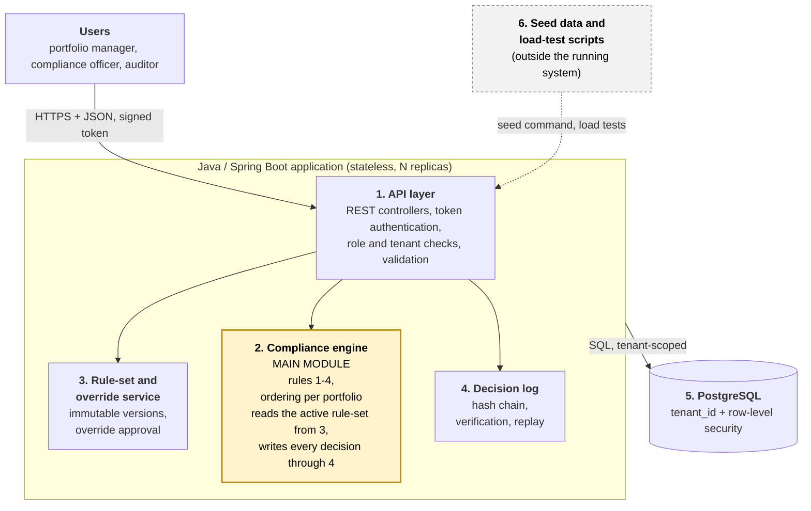

# Pre-Trade Compliance Checker

**Course project, part I: design document**

## 1. Problem and idea

**System in one sentence:** A multi-tenant web service that checks a proposed securities order against an investment firm's mandate rules before the order is sent to a broker, and returns ALLOW, WARN or BLOCK together with the exact reasons and a tamper-evident record of the decision.

**Problem and current process:** A fund manager must keep every fund inside its mandate, for example "no more than 10% of the fund in one issuer". Pre-trade compliance means checking a proposed order against such rules before execution, so that breaches are prevented instead of discovered afterwards [1][2]. We model a small investment firm that manages several funds and, as we assume, still checks orders by hand: the portfolio manager compares the order with the mandate in a spreadsheet, and the compliance officer finds breaches the next day in an end-of-day position report. Concrete shortcomings of this process:

- a breach is found after the trade, when it can only be repaired by selling positions, possibly at a loss;
- a manual check ignores orders that were already approved but not yet executed, so two orders that are each acceptable can together break a limit;
- it is hard to show later why a trade was allowed, because spreadsheets and e-mail approvals can be edited afterwards.

**Benefit:** Breaches are stopped before an order leaves the firm. Every WARN or BLOCK names the rule and the numbers behind it. Orders that were already accepted are counted. An exception needs a second person. Every decision can later be replayed and its record verified.

**Users:**

- Portfolio manager: submits one order or a batch (rebalance) for a portfolio, reads the decision and its reasons, cancels pending orders.
- Compliance officer: creates new versions of the firm's rule-set; approves or rejects overrides of blocked orders (never of an order they submitted).
- Auditor: read-only; lists decisions, verifies the decision log, replays a past decision.

Every user belongs to exactly one firm (tenant) and can see only that firm's data.

**Assumptions:**

- The situation is modelled: no real firm or real data is used, and the current process above is an assumption based on public descriptions [1][2], not an observed workflow.
- All data is simulated: fictitious firms, funds, issuers, instruments (shares and bonds, each belonging to one issuer), prices and positions; one currency (EUR).
- A daily position snapshot and its prices are assumed correct and current. An order is valued at the snapshot's reference price; fees and market impact are ignored, so a trade moves value between cash and a position without changing the fund's net asset value (NAV).
- Each firm sets its own limits. The values used in this document (10% issuer limit, 9% warning, 2% cash floor) are illustrative. A comparable real limit exists in EU UCITS funds (at most 10% of net assets in one issuer) [3][4]; its other parts are not implemented.
- An order accepted by the checker stays "pending" until it is cancelled or a new position snapshot is loaded.

## 2. Scope

| Function | What the user can do | Main module or supporting function |
|---|---|---|
| F1. Single order check | The portfolio manager submits one order and receives ALLOW, WARN or BLOCK with a result per rule; accepted orders become pending | **Main module** |
| F2. Batch check (rebalance) | The portfolio manager submits many orders at once; orders of one portfolio are evaluated one after another in submission order, different portfolios in parallel; one result per order | **Main module** |
| F3. Rule-set versions | The compliance officer creates a new immutable version of the limits and the restricted list; new checks use the active version, old decisions keep theirs | Supporting |
| F4. Override approval | A different compliance officer approves, with a reason, a BLOCK that is marked overridable; the order becomes pending | Supporting |
| F5. Decision log and replay | The auditor lists decisions, verifies the log's integrity and replays a decision from its stored inputs to get the same result | Supporting |

**Not in scope:** connections to brokers or exchanges and order execution; live market data (prices and positions come from a seed script, there are no editing screens for them); real accounting (fees, FX, derivatives, short positions); full regulatory rule libraries (for example the UCITS aggregate 40% rule or VaR limits); a graphical user interface (the system is used through a REST API and a demo script); self-service registration, single sign-on and e-mail notifications; multiple currencies; cloud deployment, high availability and database sharding (the prototype runs locally with Docker Compose); AI features.

## 3. Main module

**Name and responsibility:** Compliance evaluation engine. For one proposed order it decides whether the portfolio would still obey the firm's active rule-set if the order were executed, and explains the decision.

**Logic to be designed and tested:** (1) building the hypothetical post-trade portfolio from the snapshot, the pending orders and the new order; (2) summing exposure per issuer across all instruments of that issuer; (3) evaluating independent rules, each returning PASS, WARN or BLOCK with its numbers; (4) combining the results into one decision; (5) failing closed when data is missing; (6) evaluating orders of one portfolio strictly one after another, also under concurrent requests; (7) storing the inputs used so that the decision can be replayed.

**Input:** the order (portfolio, instrument, side, quantity). Tenant and user come from the token; the price comes from the snapshot, never from the client. Example, with the state of portfolio P1 used in all examples below: NAV €100,000,000; cash €10,000,000 (10%); issuer X exposure €8,500,000 = 8.50% (60,000 X-EQ shares at €100 plus 2,500 X-BOND units at €1,000); active rule-set v3: issuer limit 10%, warning from 9%, cash floor 2%, restricted list {R-EQ}.

```json
{ "portfolio_id": "P1", "instrument": "X-EQ", "side": "BUY", "quantity": 10000 }
```

**Output:** a decision record with one result per rule. Example for the order above (value €1,000,000):

```json
{ "decision": "WARN", "rule_set_version": 3,
  "results": [
    { "rule": "DATA_COMPLETENESS", "result": "PASS" },
    { "rule": "RESTRICTED_LIST", "result": "PASS" },
    { "rule": "ISSUER_CONCENTRATION", "result": "WARN", "issuer": "X",
      "post_trade_pct": "9.50", "warn_pct": "9.00", "limit_pct": "10.00" },
    { "rule": "CASH_FLOOR", "result": "PASS", "post_trade_pct": "9.00", "min_pct": "2.00" } ] }
```

**Flow:**

1. Authenticate; take tenant and role from the token; load the portfolio (only if it belongs to the tenant).
2. Take the portfolio's lock, so that its orders are processed one at a time.
3. Load the snapshot, the prices, the pending orders and the active rule-set version.
4. Apply rule 1 (data completeness). If it fails: BLOCK and stop.
5. Build the post-trade state: positions and cash after the pending orders and this order.
6. Evaluate rules 2-4 independently.
7. Combine: BLOCK if any rule blocks, otherwise WARN if any rule warns, otherwise ALLOW.
8. Store the decision with the inputs used and its hash-chain link; ALLOW and WARN make the order pending; return the record.

**Rules or decision steps**

1. **Data completeness (fail closed).** The instrument must exist in the firm's reference data, and a reference price must exist for it and for every instrument held in the portfolio. Otherwise BLOCK (DATA_MISSING), not overridable, and no other rule is evaluated.
2. **Restricted list.** If the order's instrument or its issuer is on the active restricted list, BLOCK (RESTRICTED_INSTRUMENT) for both BUY and SELL, not overridable.
3. **Issuer concentration.** For a BUY, post-trade exposure to the order's issuer (all its instruments, including pending orders, divided by NAV): above 10% gives BLOCK (overridable); from 9% up to and including 10% gives WARN; below 9% gives PASS. Exactly 10% is allowed. SELL orders always pass this rule. The comparison uses integers only (money in cents, limits in basis points: exposure × 10,000 > limit_bp × NAV), never floating-point numbers.
4. **Cash floor.** Post-trade cash (after the pending orders and this order) divided by NAV below 2% gives BLOCK (CASH_FLOOR, overridable); otherwise PASS.

**Scenarios for future tests** (portfolio P1 state as above):

| Scenario | Initial conditions and concrete input | Action | Exact expected result |
|---|---|---|---|
| 1. Normal case | No pending orders. BUY 3,000 X-EQ at €100 (€300,000) | Single order check | ALLOW. X exposure €8,800,000 = 8.80%; cash €9,700,000 = 9.70%; no reasons; order becomes pending |
| 2. Boundary: exactly on the limit | No pending orders. BUY 15,000 X-EQ (€1,500,000) | Single order check | WARN, not BLOCK: X exposure €10,000,000 = exactly 10.00% (allowed), warning because it is at least 9.00%; order becomes pending |
| 3. Boundary: one share over | No pending orders. BUY 15,001 X-EQ (€1,500,100) | Single order check | BLOCK, ISSUER_CONCENTRATION, overridable: exposure €10,000,100 = 10.0001% > 10.00%. (Rounded to two decimals it looks like 10.00%, so exact values must be used.) Order does not become pending |
| 4. Conflict: pending order | Order A (BUY 10,000 X-EQ, €1,000,000) was checked first and is pending. Order B, identical, arrives next | Check A, then B | A: WARN (9.50%). B: BLOCK, ISSUER_CONCENTRATION: €8,500,000 + €1,000,000 + €1,000,000 = €10,500,000 = 10.50% > 10.00%. Alone, B would have been WARN |
| 5. Hard block | R-EQ is on the restricted list (price €100 in the snapshot). BUY 50 R-EQ at €100 (€5,000) | Single order check | BLOCK, RESTRICTED_INSTRUMENT, not overridable, although the amount is tiny and the other rules pass; an override attempt is rejected |
| 6. Cash floor | Issuer Y has no position. BUY 85,000 Y-EQ at €100 (€8,500,000) | Single order check | BLOCK, CASH_FLOOR, overridable: cash €1,500,000 = 1.50% < 2.00%. Issuer Y exposure 8.50% gives PASS |
| 7. Error: cannot be evaluated | BUY 100 ZZ-EQ, an instrument missing from the firm's reference data | Single order check | BLOCK, DATA_MISSING (unknown instrument), not overridable; no other rule is evaluated; the decision is still logged |

**If the module uses AI:** Not applicable.

## 4. Quality attribute

The main attribute is **security**; the second attribute is **scalability**.

### 4.1 Main attribute: security

**Chosen attribute:** Security (tenant isolation, separation of duties, a decision log whose tampering is detectable).

**Why it matters for this system:** One database holds the positions and mandates of several competing firms. A leak between tenants exposes their strategies; a manager who can edit rules or approve their own exception makes the check meaningless; and the decisions are audit evidence, so a log that can be edited is worthless.

**Test scenario and conditions:** Local Docker Compose environment (hardware will be stated in the final document), two tenants A and B, each with one user per role, 5 portfolios and 1,000 stored decisions. Three scenarios:

- SEC-1 Tenant isolation: with a tenant A token, call every API endpoint using identifiers (portfolio, order, decision, rule-set) that belong to tenant B. The list of endpoints is taken from the router, so a new endpoint without a test fails the build.
- SEC-2 Separation of duties: a portfolio manager tries to create or activate a rule-set, to approve an override and to read the decision log; a compliance officer tries to approve an override for an order they submitted themselves; an auditor tries to submit an order.
- SEC-3 Log integrity: with 1,000 decisions stored, run 1,000 independent trials; in each, on a restored copy of the database, one random field of one random stored decision is modified directly, or a random record that is not the newest in its chain is deleted; then the verification is run.

**Success criterion:**

- SEC-1: 100% of cross-tenant requests are rejected (HTTP 404 or 403) and no data of tenant B appears in any response.
- SEC-2: 100% of the forbidden actions are rejected (HTTP 403) and recorded, while the allowed counterpart (a different compliance officer approving) succeeds.
- SEC-3: the verification detects 100% of the 1,000 manipulations and names the first broken record, reports no error on untouched data, and replaying every stored decision reproduces the same decision and reasons.

**Chosen design decision:** Tenant and role come only from the signed token, never from the request body. All queries go through one data-access layer scoped by tenant_id, and PostgreSQL row-level security is a second barrier. Role checks are a Spring Security filter chain that denies by default; the approver must differ from the submitter. Decision records are append-only and linked by a SHA-256 hash chain per portfolio (each record contains the hash of the previous one), written in the same transaction as the decision.

**How I will verify it later:** Automated tests (JUnit 5 with PostgreSQL in a Testcontainers container) for SEC-1 and SEC-2, run with a single `mvn verify`; a tamper script for SEC-3 on a copy of the database; the counts and results will be reported in the final document.

**Cost or limitation of the decision:** Extra work in every query and migration; row-level security adds complexity and a small overhead; cross-tenant administrative queries become harder. A hash chain detects modification and deletion in the middle of a chain, but not removal of the newest records unless the latest hash is stored elsewhere (out of scope). The chain makes writes for one portfolio sequential, which is acceptable because its evaluation is sequential anyway. Tokens are issued by the system itself (no external identity provider).

### 4.2 Second attribute: scalability

**Chosen attribute:** Scalability (load bursts and correctness under concurrent requests).

**Why it matters for this system:** Checks arrive in bursts: a model rebalance can send thousands of orders for hundreds of portfolios at once, and the check sits in the trader's path, so it must be fast. It must also stay correct under concurrency: two orders for one portfolio must not both pass a limit that only one of them fits under.

**Test scenario and conditions:** Local Docker Compose environment (hardware recorded), PostgreSQL seeded with a fixed random seed: 1,000 portfolios with 200 positions each and 2,000 instruments; load generator k6.

- SCA-1 Batch: one rebalance batch of 5,000 orders across the 1,000 portfolios (5 per portfolio on average), submitted at once.
- SCA-2 Steady load: 200 concurrent clients send single-order checks for 5 minutes; 20% of the portfolios receive 80% of the requests.
- SCA-3 Concurrency correctness: 100 identical orders BUY 1,000 X-EQ (€100,000 each) for portfolio P1 (state as in Section 3), sent concurrently.

**Success criterion (initial targets, to be calibrated after the first baseline measurement on the prototype):**

- SCA-1: the whole batch is processed within 30 seconds with 1 API replica; throughput with 3 replicas is at least 1.5 times that with 1 replica.
- SCA-2: 95% of requests are answered within 200 ms; error rate below 1% (WARN and BLOCK are normal answers, not errors).
- SCA-3: exactly 15 orders are accepted (4 ALLOW and 11 WARN) and 85 are blocked; the final pending exposure to issuer X is exactly 10.00%, never above.

**Chosen design decision:** Stateless API replicas: any replica can serve any request, all state is in PostgreSQL, configuration comes from environment variables. Orders of one portfolio are serialized by a row lock on the portfolio (`SELECT ... FOR UPDATE`) inside the transaction, while different portfolios run in parallel. A batch is grouped by portfolio and processed by a bounded executor whose size matches the database connection pool. Issuer exposures are pre-aggregated when a snapshot is loaded, so a check does not scan all 200 positions. Reference data and rule-sets are cached in memory, which is safe because rule-set versions are immutable.

**How I will verify it later:** A k6 script and the seed generator in the repository; a JUnit concurrency test for SCA-3; runs with 1 and 3 API replicas (`docker compose --scale`); a results table with hardware and commands in the final document.

**Cost or limitation of the decision:** A single very active portfolio is limited by its sequential processing (throughput at most 1 / evaluation time). Caches and pre-aggregated exposures add consistency work (limited by immutable versions and by updating on snapshot load). One PostgreSQL instance is the bottleneck and there is no sharding. On one laptop the load generator, the API and the database share the CPU, so only relative scaling is shown, not production capacity.

## 5. Initial system structure

**Simple diagram**



| System part | Responsibility |
|---|---|
| 1. API layer | HTTP/JSON endpoints, token authentication, role and tenant checks, input validation; contains no business rules. Stateless, runs as N replicas. |
| 2. Compliance engine (main module) | Builds the post-trade state, evaluates rules 1-4 (each rule is a separate component behind one interface, so a rule can be added without changing the engine: Strategy pattern, open/closed principle), combines the results, processes the orders of one portfolio one at a time, runs batches in a bounded executor. Reads the active rule-set from (3) and writes every decision through (4). |
| 3. Rule-set and override service | Immutable rule-set versions per tenant, activation, override requests and approvals (approver is not the submitter). |
| 4. Decision log | Append-only decision records with the inputs used, a SHA-256 hash chain per portfolio, integrity verification and replay. |
| 5. PostgreSQL | All persistent data; tenant_id on every table, row-level security, transactions and row locks. |
| 6. Seed data and load-test scripts | Generator of simulated tenants, portfolios, instruments, prices and snapshots (fixed random seed) and k6 scripts; not part of the running system. |

**Planned technologies and reasons for the choice:**

- Java 21 with Spring Boot 3 (Maven): static typing, `long` for money in cents, `java.util.concurrent` for batch processing, SHA-256 in the standard library (`MessageDigest`), and Spring Security for token authentication and role checks.
- PostgreSQL: transactions, row locks for per-portfolio ordering, row-level security for tenant isolation, JSONB for the stored decision inputs; accessed through Spring Data JPA with Flyway migrations, all repositories scoped by tenant.
- Docker and Docker Compose: one command from the README (`docker compose up`), replicas with `--scale`, configuration through environment variables (the course's cloud-first principles).
- REST with JSON and an OpenAPI description: simple to demonstrate and to test.
- Testing: JUnit 5 and AssertJ for unit tests, Testcontainers for integration tests against a real PostgreSQL, Checkstyle and SpotBugs for static analysis, k6 for load tests.
- Money as integer cents and limits as basis points, so there are no floating-point comparisons.

## 6. AI usage

### AI in preparing this document

I used AI to prepare this document.

| Tool and task | What I used | What I rejected or rewrote and why | How I checked |
|---|---|---|---|
| Claude (Anthropic): finding a project idea in the banking and investing domain | A list of candidate ideas with their security and scalability angles; the chosen idea: a pre-trade compliance checker | Rejected the first batch (similar backend-infrastructure ideas); rejected a card-payment authorization engine because its logic reduces to one conditional SQL update and would look like CRUD; trimmed the compliance checker from a full rule library to four rules so that it can be built | Compared each idea with the assignment's requirement that the module must contain meaningful business logic, not only create, view, edit and delete operations |
| Claude: explaining the domain (what pre-trade compliance is, typical rules, numeric examples) | The explanation of pre-trade checks, rule types and the worked example with 8.5% / 10% | Replaced informal explanations with my own list of assumptions (Section 1); dropped a UCITS-style aggregate rule and VaR | Compared with the public sources listed below; recalculated all numeric examples (Sections 3 and 4) |

### Planned AI usage when building the system

**Where and for what I will use AI:** Boilerplate (REST controllers, DTO classes, SQL migrations, the seed generator), drafts of unit tests from the rule descriptions, refactoring suggestions, code review before committing, the README and API documentation, k6 scripts. The rule logic, the expected test values and the security design are decided by me first; AI does not set them.

**How I will check suggestions and generated code:** I read and understand every generated line before committing it; run the tests and static analysis (Checkstyle, SpotBugs); review AI-generated tests to confirm that they assert the values from Section 3 and fail when a rule is deliberately broken; write or review line by line the security-critical code (tenant scoping, role checks, the hash chain) and cover it with the SEC tests; and keep a log of what AI generated, what I rejected and why, for the final stage's AI usage report.

**Risks I see:** plausible but wrong financial logic; a generated query that misses the tenant filter; library functions that do not exist; tests that only mirror the implementation. The mitigations are the checks above.

**Will AI be part of the system's functionality:** No. The compliance decision must be deterministic, explainable and replayable (Section 3, F5), and AI answers would not give it these properties.

## 7. Further work plan

| Work | Tangible result | Planned order |
|---|---|---|
| 1. Foundation | `docker compose up` starts the Spring Boot API and PostgreSQL; schema with tenant_id and row-level security; token login with three roles; seed generator for two tenants; first isolation test | Week 1 (Oct 5-11) |
| 2. Compliance engine | Rules 1-4 as separate components; post-trade state with pending orders; unit tests for all 7 scenarios of Section 3 pass | 2 weeks (Oct 12-25) |
| 3. API and workflows | Single and batch check endpoints; rule-set versions; override approval; decision log with hash chain, verification and replay | 2 weeks (Oct 26 - Nov 8) |
| 4. Prototype completion | Per-portfolio lock and a concurrency test; basic tenant-isolation tests; README with one-command start and the demo script | Week 6 (Nov 9-15) |

The prototype is due 2026-11-16 (stage 2) and the final solution 2026-12-14 (stage 3); the load measurements, the full security test suite and the architecture document belong to the final stage.

**Prototype demonstration scenario:** Tenant "Firm A", fund P1 (initial state: NAV €100,000,000, issuer X at 8.5%, cash 10%), rule-set v3.

1. The portfolio manager submits BUY 10,000 X-EQ. Expected: WARN, 9.50%.
2. The same order is submitted again. Expected: BLOCK, 10.50% (the pending order is counted).
3. A different user, a compliance officer, approves the override with a reason. Expected: the order becomes pending; the same portfolio manager attempting this gets 403.
4. A user of "Firm B" requests this decision. Expected: 404.
5. The auditor replays the decision from step 1 and verifies the log. Expected: identical result (WARN, 9.50%) and no errors.
6. A stored decision is modified directly in the database and the auditor verifies the log again. Expected: verification fails and names the modified record.

| Risk or uncertainty | How I will check or reduce it |
|---|---|
| 1. Concurrency errors: two orders of the same portfolio both pass a limit | Portfolio row lock; the SCA-3 test (100 concurrent orders, exactly 15 accepted) run from the first version of the endpoint; fallback: an in-application queue per portfolio |
| 2. Misunderstanding finance terms (NAV, issuer grouping, pending orders) and scope creep into CRUD | Keep the rule-set small, write the assumptions down, check definitions in public sources, fix the rules in tests, use the lecturer's feedback on this document; keep administrative endpoints to a minimum |
| 3. The initial performance targets may be unrealistic on a laptop and measurements may be noisy | Baseline measurement at the prototype stage, with a JVM warm-up phase before measuring; recalibrate the targets, record the hardware, compare 1 and 3 replicas relatively |

**Sources**

1. Pre-trade Compliance (glossary), CompanyView. https://companyview.io/glossary/pre-trade-compliance
2. Pre-Trade Compliance Rule Evaluation Engine, Golden Door Asset. https://www.goldendoorasset.com/workflows/pre-trade-compliance-rule-evaluation-engine
3. When is an index too concentrated?, LSEG FTSE Russell. https://www.lseg.com/en/insights/ftse-russell/when-is-an-index-too-concentrated
4. UCITS: A modern twist or a perilous direction?, S&P Global. https://www.spglobal.com/market-intelligence/en/news-insights/research/ucits-a-modern-twist-or-a-perilous-direction
5. Course "Programų sistemų projektavimas": introductory lecture slides and the stage 1 assignment description (quality attributes, requirements).
